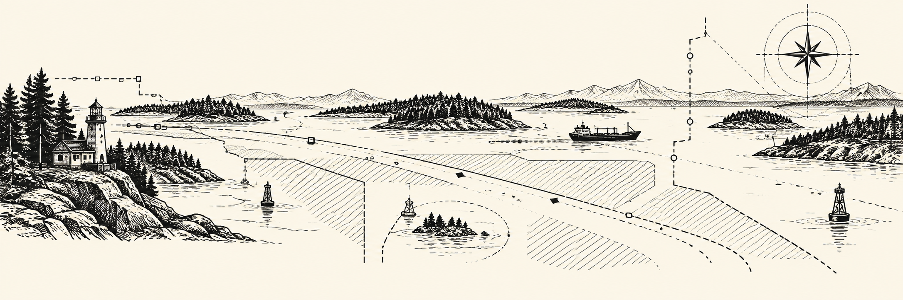
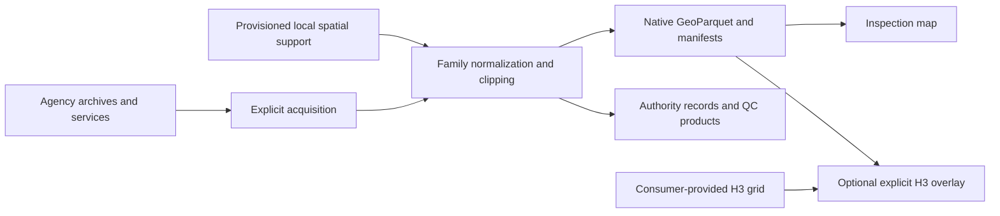

Start with the [single-layer getter](query-api.md); use the advanced workflows below for local products and releases.

# Source-backed context for marine governance

`toolkit-governance` turns agency datasets into inspectable marine governance
geometry: protected areas, sanctuaries, jurisdictional reference boundaries, and
fisheries management areas. It installs independently, with a **`governance`**
Python package and command.

The toolkit preserves source identity, native geometry, citations, dates, and
coverage. Every canonical product uses **EPSG:4326 GeoParquet**, paired with a
checksum manifest. Geometry is reference evidence; legal instruments and official
coordinates remain the controlling authorities.

<div class="grid cards" markdown>

- :material-layers-outline: **Explore the layers**<br>
  Seventeen implemented collections, their source inputs, exact output files, and
  interpretation limits.<br>
  [Inputs and outputs →](layers.md)

- :material-play-circle-outline: **Run the toolkit**<br>
  Install, initialize a workspace, acquire a selected collection, build, and
  inspect it.<br>
  [How to use →](how-to-use.md)

- :material-file-check-outline: **Read the evidence**<br>
  Feature identities, geometry parts, coverage, effective dates, and verified
  manifests.<br>
  [Product contracts →](CONTRACTS.md)

- :material-map-outline: **Choose a consumer grid**<br>
  An optional explicit H3 overlay keeps native products intact and retains
  missingness and provenance.<br>
  [H3 overlay →](h3-matrix.md)

</div>

## What is implemented

| Family | Collections | Published context |
| --- | --- | --- |
| Protected areas | MPAs; sanctuaries; critical habitat; selected refuges; reported marine classifications | Native reference geometry, separate interest points, authority records, and qualified classification views |
| Jurisdiction | International boundaries; federal waters; state/provincial waters; counties; BIA/NRCan administrative references | Source-preserving boundaries, derived support, availability, reconciliation, and distinct provider systems |
| Fisheries management | Management areas | WDFW recreational marine-area polygons and optional study crosswalks; quantity systems remain qualified separately |
| Vessel management | Shipping references; traffic-separation components | Typed CHS/NOAA source and component roles, without pooled route claims |
| Administrative context | Ports; Coast Guard references | Physical port points and separate USCG/CCG administrative inventories |

The catalog contains **24 entries: seventeen implemented collections and seven planned
families**. Implementation does not imply complete regional coverage. The default
processing extent is the Northeast Pacific, from 180°W to 109°W and 32°N to 72°N.
See [layers](layers.md) for collection-specific support.

## Start with an empty workspace

From a clone, with Python 3.11+:

```sh
python -m venv .venv
source .venv/bin/activate
python -m pip install .
governance --workspace ./governance-workspace init
governance --workspace ./governance-workspace catalog
```

These commands install the toolkit, copy missing configuration, and inspect the
catalog. They acquire no source data. Continue with [how to use](how-to-use.md)
to review configuration and explicitly download and build a collection.

## How data flows



Downloads retain raw snapshots. Builds operate on local inputs and publish
per-file outputs. Inspection writes a map and its manifest; it does not promote
a release. International-boundary reconciliation also needs explicitly
provisioned local spatial support.

!!! note "Interpretation boundaries"
    A missing source or empty intersection is not evidence of absence. Mapped
    membership does not establish a legal activity rule. All fields remain
    **model-ineligible by default**. Read [limitations](limitations.md) and
    [sources and rights](reference/sources.md) before downstream use.

## Frozen studies and local delivery

The [frozen-study guide](study-guide.md) covers explicit grids, masks, cached
source support, static inventory delivery, fishing-area relations, independent
checks, and immutable local generations. Read the [source acceptance inventory](source-acceptance.md)
and [production readiness](production-readiness.md) for retained evidence and
remaining regional/scientific qualification. All current collections remain
research-only; a new documentation build does not refresh that evidence.
