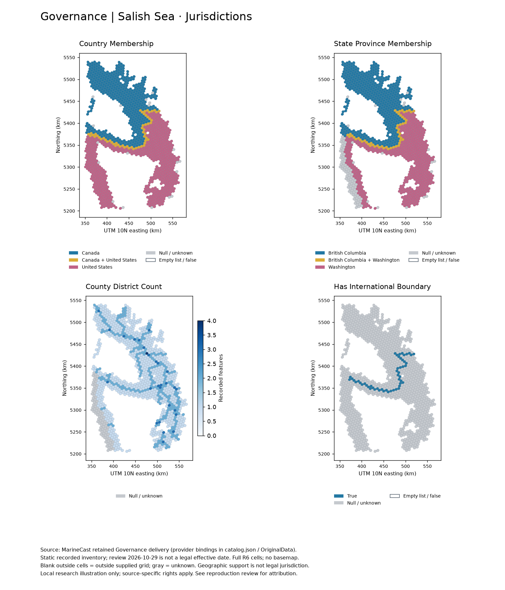
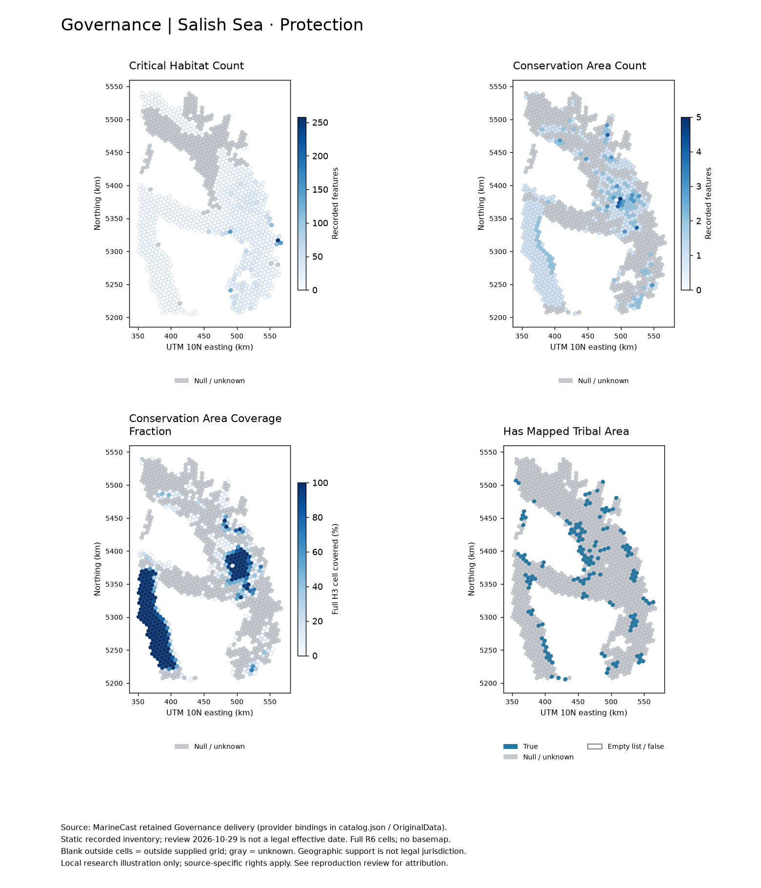
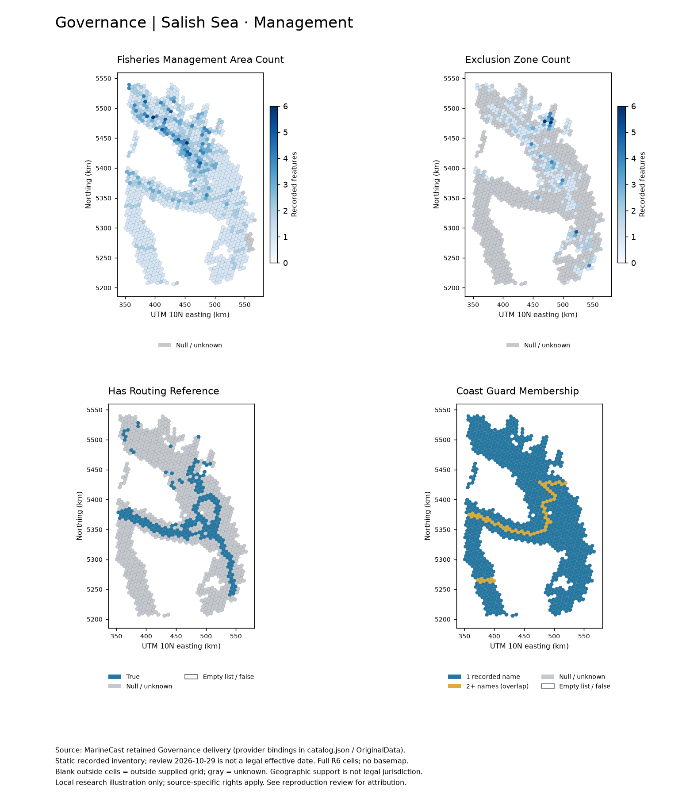
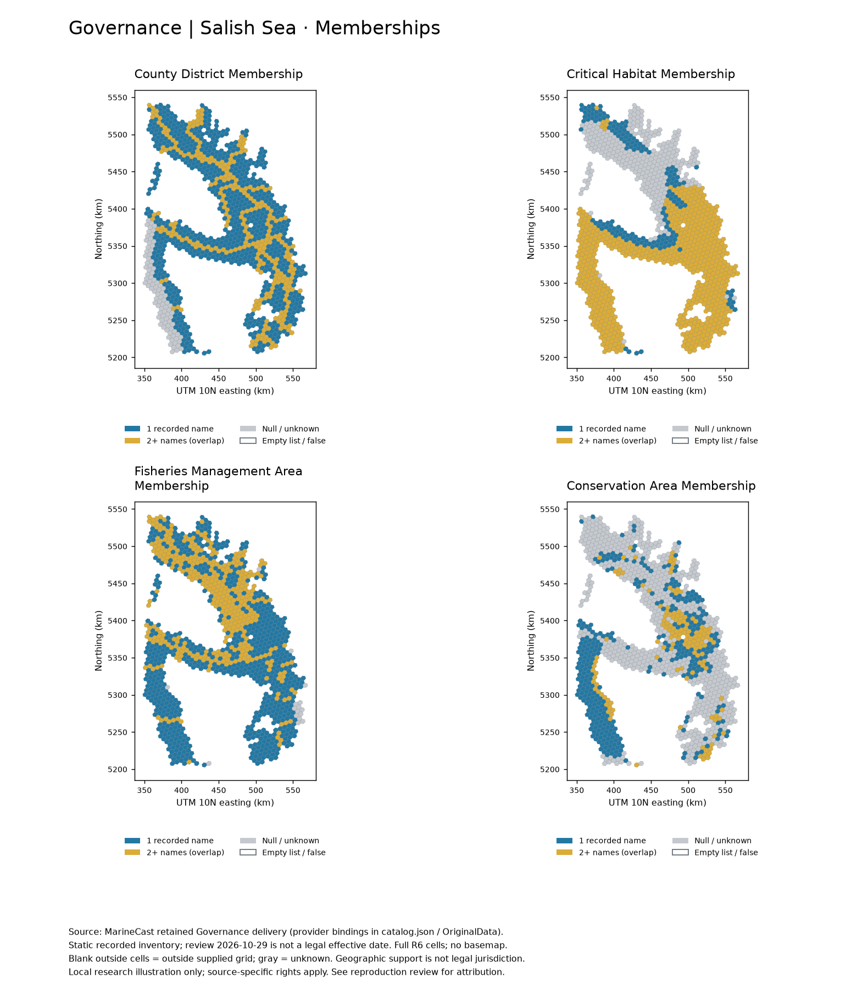
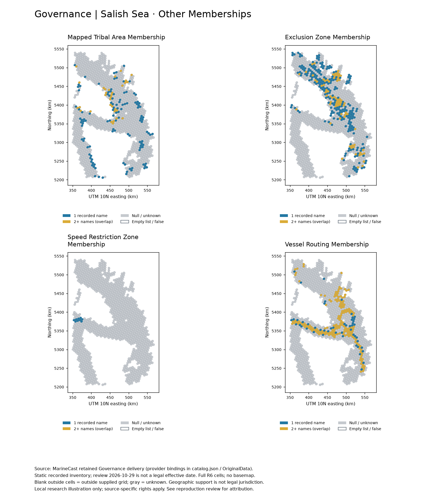

# Reproducibility review and example maps

Initial review date: **2026-10-29**; full regional replay: **2026-11-01**.
The initial review covered the then-current local working tree and retained
delivery, including the existing application-only name projection.
It does not certify legal authority, provider completeness or a dated history.

**Implementation update — 2026-11-01:** new v5 writers embed scientific support
inside final Parquets and remove disposable build/coverage intermediates. The
retained Data/Governance products reviewed here remain unchanged v4 inputs and
still require their original external audits. The historical replay counts and
parity below do not certify the corrected overlay method's full regional output;
see the [current product contract](parquet-products.md).

## Full regional retained-original rebuild — 2026-11-01

The installed toolkit 0.5.0 wheel rebuilt all sixteen collections from all 49
retained OriginalData datasets on every delivered R6/R8 H3 key. Source membership
and row order came from the existing delivery; this is not an independent proof
of the original grid construction or exhaustive geographic source coverage.
The run executed normalization, native processing, complete regional overlays,
derived feature materialization, v5 publication and final validation in a temporary
workspace outside Data. Network access was disabled and consumer/sibling package
imports were blocked. The build passed in **35.9 minutes**; comparison took 28.8 seconds.

| Grid | Rows | Selected feature values | Changed values | Restored scientific columns | Changed scientific values |
| --- | ---: | ---: | ---: | ---: | ---: |
| R6 | 2,621 | 52,420 | 0 | 61 | 0 |
| R8 | 88,243 | 1,764,860 | 0 | 61 | 0 |

All **1,817,280 selected feature values** matched exactly, including null masks,
ordered membership lists and Arrow types. H3 keys and row order, static temporal
meaning, full-cell spatial support, coordinate systems, units and support-state definitions
matched. Restored scientific arrays, paired source identities and part lineage
matched exactly. All 49 newly written original GeoParquets were byte-identical to
their retained inputs; source catalog entries and source/receipt metadata matched.
The rebuilt metric Parquet bytes differ because v5 embeds support and records the
new run's software/method, configuration and build metadata.

All 52 existing Data/Governance files and both required legacy audit files retained
their exact checksums. No delivery was replaced. The builder removed native,
coverage and overlay temporary files and produced no external audit directory.
After comparison, the temporary candidate, grids, initialized workspace and wheel
installation were removed. A small
[machine-readable result](assets/review/regional-rebuild-20261101.json) retains
versions, fingerprints, comparison counts and cleanup/preservation evidence.

This validates full regional processing from these retained originals with overlay
method 1.3.1. It does not establish fresh provider acquisition, current law,
exhaustive inventories, independent grid qualification or model eligibility.
The older bounded replay below remains a separate historical check.

## What is delivered

The inspected delivery has 2,621 R6 rows and 88,243 R8 rows. Each table has
`h3_index` plus the twenty fields in the [physical schema](reference/columns.md).
Both are static; there is no delivered dynamic table. `catalog.json` binds 49
retained source GeoParquets. The public name lists are derived from scientific
support in immutable **external audit Parquets**. Those audit files are required
by validation even when only rebuilding from originals; the original catalog
and geometry directory alone are not a portable copy of a compact delivery.

Installed-wheel validation of the retained delivery passed for both tables and
all 49 originals. The existing environment did not have `governance` installed;
a regular wheel built from the current source was installed in an isolated
location. The offline test suite passed **282 tests**; `pip check` passed.
The first test invocation used an uninitialized working directory and failed
configuration lookup. Running from the copied owning checkout resolved that
harness error; it was not a production-code fix.

The offline installed-wheel build **reproduced every sampled delivered value
exactly**: 37 R6 cells and 42 R8 cells × twenty fields (1,580 field values,
including whole membership lists). Both replay tables validated with 49
retained originals. H3 key sets, Arrow field types, nulls, numeric ranges,
list ordering, static time meaning, full-cell support, EPSG:6933 area and
EPSG:32610 length semantics matched. No tolerance was needed. The comparison
ran outside the checkout with OrcaCast, Seascape and application package
imports blocked. See [machine-readable comparison](assets/review/comparison.json).

The resumed build took approximately nine minutes locally; normalization of
retained geometry dominated despite the small grid. It did not download data
or alter the delivered products. Parquet byte hashes differ, as expected for a
subset with new build metadata and audit locations. This establishes **bounded
real-data semantic parity**, not full 90,864-cell regeneration, historical
reproducibility, provider refresh correctness or legal validation.

All five map PNGs were visually inspected after correcting a footer overlap.
Strict MkDocs and `git diff --check` passed. No production code was changed;
the only functional documentation correction was the current
`critical_habitat_count` quickstart column.

## Repeat the bounded check

Use Python 3.11+ and the package dependencies in `pyproject.toml`. The review used
Python 3.14 and a regular `toolkit-governance` 0.4.0 wheel. Run from the owning
checkout after installation. Example scripts are repository tools, not public
package CLI subcommands. Set the two paths below to an intact retained delivery
and a **new** review directory outside the delivery tree.

```sh
python -m pip install .
RETAINED=/absolute/path/to/Data/Governance
REVIEW=/absolute/path/to/new-governance-review
python scripts/review_replay.py prepare "$RETAINED" "$REVIEW"
governance --workspace "$REVIEW/workspace" init
governance validate-data "$RETAINED"
governance --workspace "$REVIEW/workspace" build \
  --grid "$REVIEW/grid-r6.parquet" --grid "$REVIEW/grid-r8.parquet" \
  --original-data "$RETAINED" --output-directory "$REVIEW/rebuilt" \
  --allow-partial --keep-workspace-data
python scripts/review_replay.py compare "$RETAINED" "$REVIEW"
```

Preparation selects the first two examples of present, missing and zero/empty
values where available for every field, plus three nearest delivered cells to
each of six fixed regional reference points. Selection uses the retained row
order; it is a deterministic diagnostic sample, not random sampling or proof of
full geographic coverage. The inspected delivery selected **37 R6 and 42 R8
cells**. The comparison checks the exact H3 key set, Arrow field types, every
sampled value (including list order), null counts, numeric ranges, static time
meaning, full-cell support and coordinate systems. It writes `comparison.json`
and returns nonzero on any value, key, schema or semantic discrepancy.

The build normalizes retained source geometry across the configured extent even
for this small grid. Source normalization can dominate runtime. Budget about
2 GB of temporary space for this review; it is not a seconds-only unit test.
No network acquisition is required. The build writes new originals and external
audits under the review workspace; no `--overwrite` or cleanup command is used.
A successful replay may differ byte-for-byte because the grid, build metadata,
audit paths and Parquet encoding differ. Semantic equality is checked separately.

## Inputs and qualifications

- Retain `catalog.json`, both delivered Parquets, all catalog-bound `OriginalData`
  members, and all checksum-bound external audits at their recorded absolute
  paths. Copying or relocating only the public tables breaks validation. No
  migration backup or Trash contents are needed for the inspected delivery.
- `init` supplies packaged configuration without downloads. Custom configurations
  and the installed code version must be retained for a later replay; a version
  number alone does not identify an uncommitted working tree.
- Supply the exact intended H3 cell IDs for complete regeneration. The example
  derives a subset from the delivery, not an independent proof of the original
  grid construction. Full native H3 cells are used, not clipped model-water cells.
- Current collections remain partial and model-ineligible. Source receipts,
  geometry vintage, retrieval time, build time and legal effective dates differ.
  Null means unknown/unavailable support; it must not be replaced with zero,
  false, an empty list or an assumed international-water assignment.
- County/district counts count the documented source identity. Name-list length
  counts distinct displayed names and may differ from source feature counts.
  Overlapping memberships are preserved; no dominant assignment is chosen.
- Reacquisition was not tested. Provider changes, missing originals, legal
  qualification and a complete historical replay remain outside this check.

## Recreate the documentation maps

The figures below are local research illustrations of the **delivered** table,
not maps made from the replay sample. They cover all twenty public fields in
five panels of four. Select a figure to open it at full resolution. They use the 47–50°N, 125–122°W cell-center window, full R6
cell polygons and EPSG:32610 coordinates. There is no downloaded basemap.

```sh
python -m pip install matplotlib
python scripts/example_maps.py "$RETAINED" /absolute/path/to/new-map-output
```

The [map evidence](assets/review/map-evidence.json) and [code/input evidence](assets/review/code-evidence.json) retain the inspected fingerprints.

The script writes five PNGs and a small `map-evidence.json` containing the input
hash, extent, displayed row count and per-field null counts. Numeric count maps
have separate, labeled scales; the stored conservation fraction is displayed
as percent. Category maps show country/state names and their overlaps. Other
membership maps distinguish one name from multiple names, rather than inventing
an exclusive category. Gray is null/unknown, white outside the supplied cells
is outside-grid space, and white inside a categorical cell means an observed
empty list or false flag. Empty states in the legend are possible encodings,
not claims that the current partial source inventory establishes absence.

### Geographic assignments and boundary references

[](assets/review/jurisdictions.png)

Country and state/province colors are **geographic model-water assignments**,
not legal marine jurisdiction or ownership. A two-name cell intersects both
supported areas; it does not imply a territorial dispute. Boundary flags mark
full-cell intersections with retained lines, not a survey-precision border.

### Protection and mapped land-area references

[](assets/review/protection.png)

Tribal/reserve references are source-specific mapped administrative or land-area
records, not sovereign territories, tribal identities, treaty rights or fishing
entitlements. Habitat feature counts are not species abundance or area.

### Management and routing references

[](assets/review/management.png)

An exclusion or routing reference is not a current operational restriction.
The source date and qualification must be checked before interpreting a rule.

### Membership overlaps

[](assets/review/memberships.png)

[](assets/review/other-memberships.png)

## Sources, attribution and rights

These illustrations derive from the retained MarineCast Governance catalog,
not a newly downloaded inventory. Attribution includes U.S. Census Bureau,
British Columbia administrative boundaries, BIA, NRCan, retained geographic
water support, IBC/NOAA boundary references, NOAA and USFWS habitat/protection
sources, Canadian ECCC and DFO sources, fisheries agencies, and the documented
Coast Guard and vessel-rule sources. Exact source identities, receipt dates,
versions, licence text and processing rules remain in the catalog, originals
and [source-family guides](reference/sources.md); the map review date is not a
source vintage or legal effective date.

**Local research use only; no publication occurred.** The software's Apache-2.0
licence does not grant data rights. DFO blank-rights cases, ADF&G restrictions
and unresolved USCG clearance still require source-specific review before
redistributing affected data or derived figures. Canadian OGL attribution and
no-endorsement conditions apply where stated; source-specific qualifications
are not superseded by this gallery.
